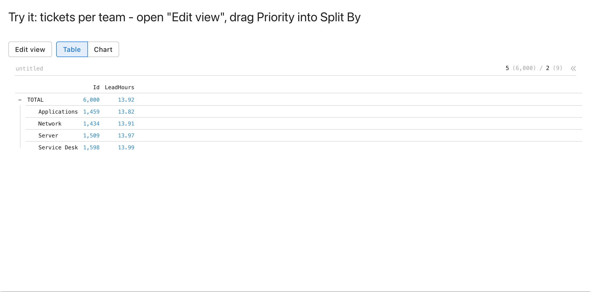
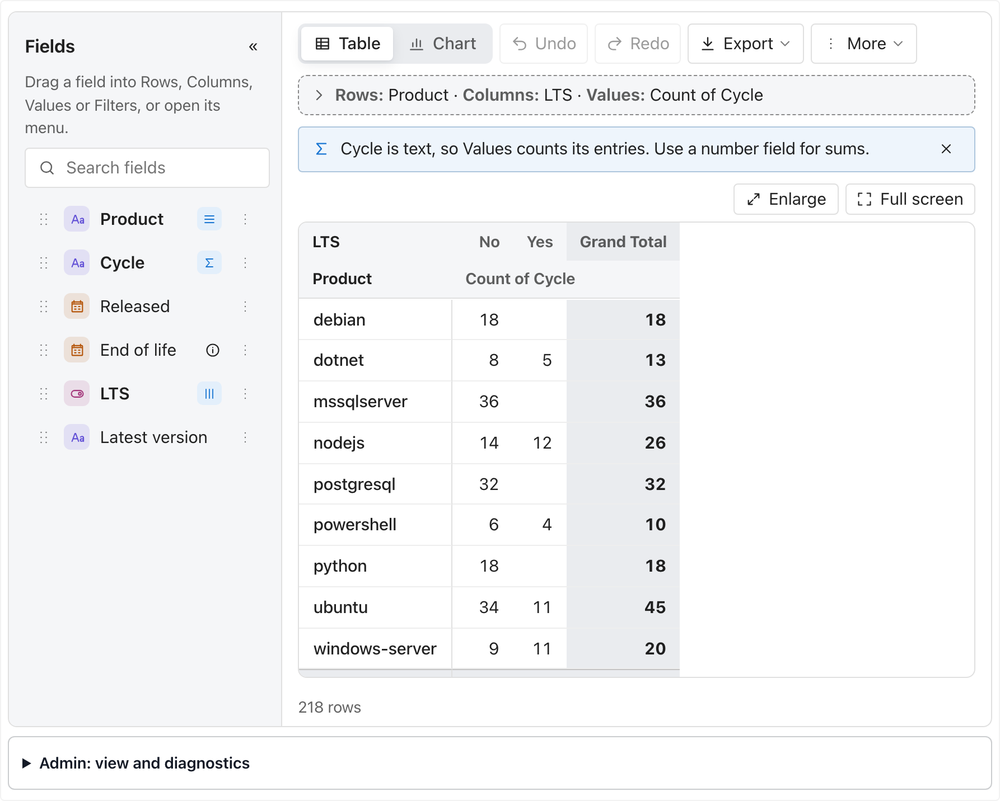
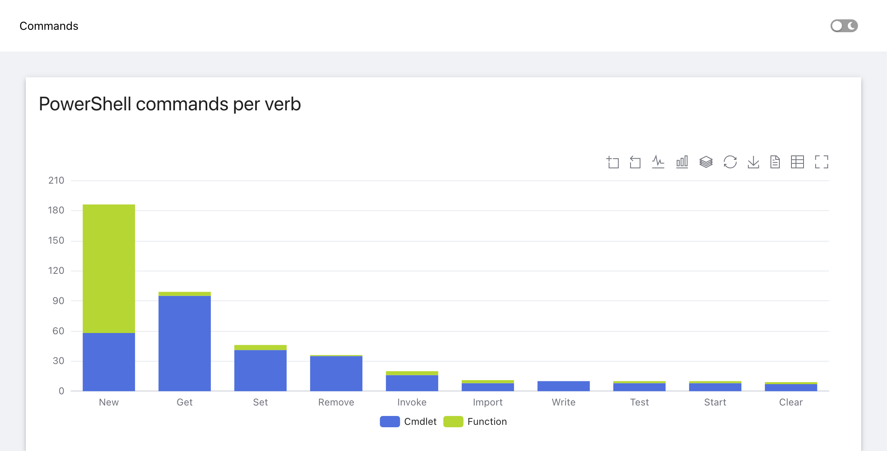

<p align="center">
  <picture>
    <source media="(prefers-color-scheme: dark)" srcset="assets/header-dark.svg">
    
  </picture>
</p>

<p align="center">
  Custom components for <a href="https://devolutions.net/powershell-universal/">PowerShell Universal</a> apps,
  each one a PowerShell module you install on its own: interactive <a href="https://echarts.apache.org/">Apache ECharts</a>
  charts, a <a href="https://perspective-dev.github.io/">Perspective</a> datagrid, pivot and chart, and a pivot report builder,
  fed straight from SQL, REST and PowerShell.
</p>

| Build | Platform | Project |
| --- | --- | --- |
| [](https://github.com/eizedev/powershell-universal-components/actions/workflows/ci.yml) [](https://github.com/eizedev/powershell-universal-components/actions/workflows/docs.yml) |     | [](https://www.powershellgallery.com/packages/PowerShellUniversal.Component.ECharts) [](https://www.powershellgallery.com/packages/PowerShellUniversal.Component.Perspective) [](https://www.powershellgallery.com/packages/PowerShellUniversal.Component.Pivot) [](LICENSE) [](modules/PowerShellUniversal.Component.ECharts/CHANGELOG.md) |

**Documentation: [powershell-universal-components.eize.dev](https://powershell-universal-components.eize.dev/)** - every module, every parameter and
every chart type, with live examples next to their code.

| ECharts | Perspective | Pivot |
| --- | --- | --- |
|  | <picture><source media="(prefers-color-scheme: dark)" srcset="docs/assets/perspective-viewer-1-dark.png"></picture> | <picture><source media="(prefers-color-scheme: dark)" srcset="docs/assets/pivot-report-dark.png"></picture> |

## Modules

| Module | What it adds |
| --- | --- |
| [PowerShellUniversal.Component.ECharts](https://powershell-universal-components.eize.dev/echarts/) | `New-UDEChart`: 29 chart types, from bars and lines to gantt, rankings, radial bars, network graphs, trees and KPI matrices; zoom, range selection, click events that filter other elements, linked charts, trends with forecast, `-Aggregate`, `-EventColumns`, CSV/Excel/PNG export, full screen, light and dark theme, corporate themes (`-LightTheme`/`-DarkTheme`, CSS variables), fixed colours per category (`-ColorMap`). |
| [PowerShellUniversal.Component.ECharts.Demo](https://powershell-universal-components.eize.dev/demo/) | `New-UDEChartShowcase`: the showcase app of the chart module as a module - 14 pages of examples with generated and public data, to try the charts or copy from. |
| [PowerShellUniversal.Component.Perspective](https://powershell-universal-components.eize.dev/perspective/) | `New-UDPerspective`: [Perspective](https://perspective-dev.github.io/) datagrid, pivot table and WebGL charts in one, which readers group, split, filter and sort themselves; WebAssembly engine for large row counts. |
| [PowerShellUniversal.Component.Pivot](https://powershell-universal-components.eize.dev/pivot/) | `New-UDPivotReport`: a pivot report builder on [pivotkit](https://www.npmjs.com/package/pivotkit-react) - readers drag fields into rows, columns, values and filters and get a table or a chart, with date grouping, drill-down to the source rows, shared views and views readers keep (in files, a database or the browser; roles for who publishes), undo, Excel/CSV/PNG export and copy, English and German. |
| [PowerShellUniversal.Component.Pivot.Demo](https://powershell-universal-components.eize.dev/pivot/demo/) | `New-UDPivotShowcase`: the showcase app of the pivot module as a module - the documentation's examples on endoflife.date, weather from Open-Meteo (shipped snapshots or live), your own CSV and JSON files, and a 5,000-row ticket report, in English and German. |

Tested on PowerShell Universal 2026.2.5 and 2026.3.4 in Chromium, Firefox and WebKit (the engine of
Safari; the Safari app and iOS are not tested).

## Quick start

```powershell
Install-PSResource -Name PowerShellUniversal.Component.ECharts   # or copy the built module into Modules/
```

A first app that runs on any PSU server, without a database or an API: the PowerShell commands of the
server per verb, split into cmdlets and functions. A click on a bar shows a toast. The same app is in
[examples/quickstart.ps1](modules/PowerShellUniversal.Component.ECharts/examples/quickstart.ps1).

```powershell
New-UDApp -Title 'Commands' -Content {
    New-UDCard -Title 'PowerShell commands per verb' -Content {
        $commands = Get-Command -CommandType Cmdlet, Function | Where-Object Verb
        $top = $commands | Group-Object Verb | Sort-Object Count -Descending | Select-Object -First 10 -ExpandProperty Name
        $rows = $commands | Where-Object Verb -In $top | Group-Object Verb, CommandType | ForEach-Object {
            [pscustomobject]@{ Verb = $_.Group[0].Verb; Type = "$($_.Group[0].CommandType)"; Commands = $_.Count }
        } | Sort-Object { [array]::IndexOf($top, $_.Verb) }   # most commands first
        New-UDEChart -Data $rows -Type bar -X Verb -Y Commands -GroupBy Type -Stacked -Height 360px -OnClick {
            Show-UDToast -Message "$($EventData.name): $($EventData.value) $($EventData.seriesName)s"
        }
    }
}
```

<p align="center">
  <picture>
    <source media="(prefers-color-scheme: dark)" srcset="assets/screenshot-quickstart-dark.png">
    
  </picture>
</p>

With your own data it is the same call. From SQL Server, for example:

```powershell
$byTeam = Invoke-Sqlcmd -Query 'SELECT Team, Priority, COUNT(*) AS Tickets FROM Tickets GROUP BY Team, Priority'
New-UDEChart -Data $byTeam -Type bar -X Team -Y Tickets -GroupBy Priority -Stacked
```

DataTables, `Invoke-RestMethod` results and PowerShell objects go in as they are; column names are
matched without regard to case. Empty data shows "No data" (`-EmptyText` for your own text), and a
column name that matches no column shows the columns the data has instead of a chart.

More in the documentation: [Getting started](https://powershell-universal-components.eize.dev/getting-started/) (your own data from SQL, REST and
PowerShell), [chart types](https://powershell-universal-components.eize.dev/echarts/), [interaction and events](https://powershell-universal-components.eize.dev/echarts/interaction/),
[themes and corporate design](https://powershell-universal-components.eize.dev/echarts/themes/), [Perspective](https://powershell-universal-components.eize.dev/perspective/), [Pivot](https://powershell-universal-components.eize.dev/pivot/) and the
[ECharts showcase app](https://powershell-universal-components.eize.dev/demo/) with 14 pages of examples.

<p align="center">
  
</p>

## Development

Build, tests and the documentation site: [Development](https://powershell-universal-components.eize.dev/development/); releases:
[Releases](https://powershell-universal-components.eize.dev/development/release/). Contributors and coding agents: [AGENTS.md](AGENTS.md),
[CONTRIBUTING.md](CONTRIBUTING.md); security reports: [SECURITY.md](SECURITY.md).

## License

[MIT](LICENSE). Bundled libraries keep their own licenses (Apache ECharts: Apache-2.0, ZRender:
BSD-3-Clause, fflate: MIT, tslib: 0BSD, Perspective and regular-table: Apache-2.0, pivotkit and dnd-kit: MIT, PSU's universal-dashboard
helper: ISC); the build writes their texts and notices into each module's `THIRD-PARTY-NOTICES.txt`.
Icon, header and social preview in `assets/` are generated in [eizedev/brand](https://github.com/eizedev/brand)
and licensed [CC BY 4.0](https://creativecommons.org/licenses/by/4.0/).
