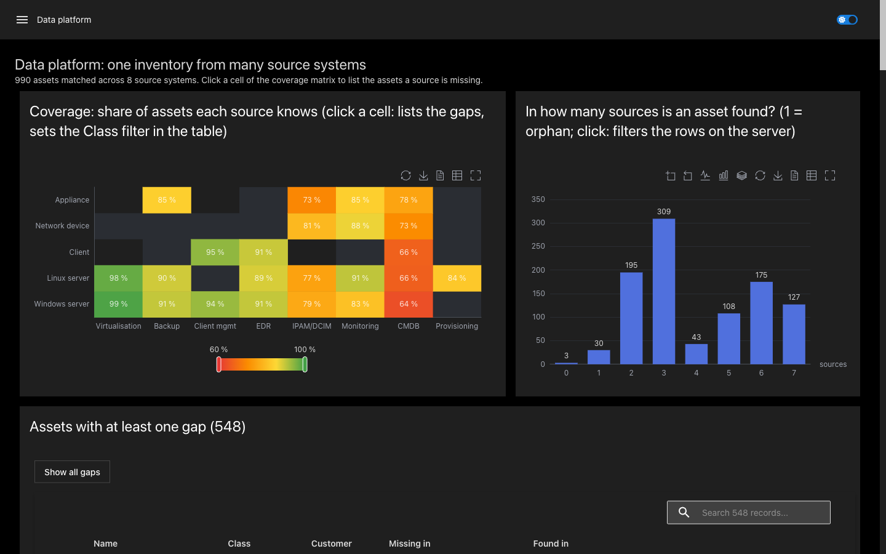
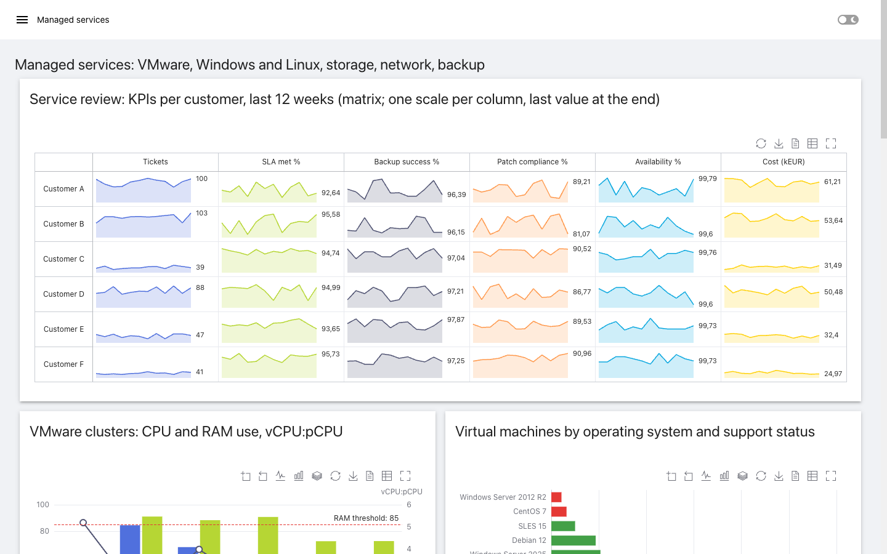
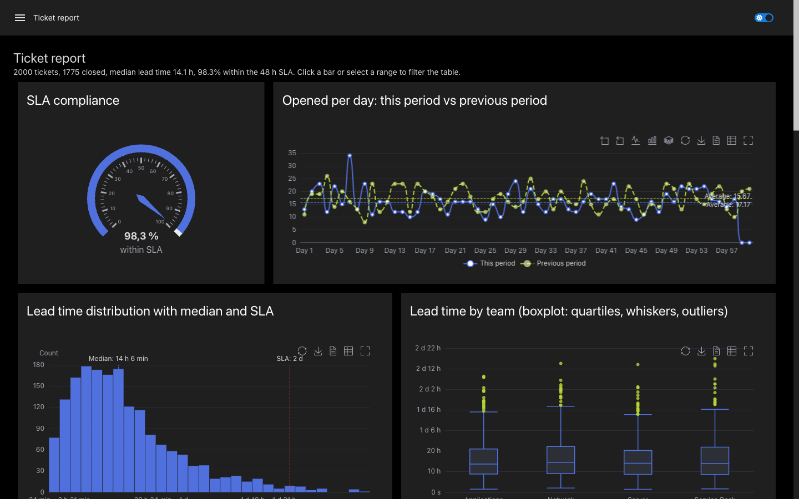

<p align="center">
  <picture>
    <source media="(prefers-color-scheme: dark)" srcset="assets/header-dark.svg">
    
  </picture>
</p>

<p align="center">
  Custom components for <a href="https://devolutions.net/powershell-universal/">PowerShell Universal</a> apps,
  each one a PowerShell module you install on its own - starting with interactive
  <a href="https://echarts.apache.org/">Apache ECharts</a> charts fed straight from SQL, REST and PowerShell.
</p>

| Build | Platform | Project |
| --- | --- | --- |
| [](https://github.com/eizedev/powershell-universal-components/actions/workflows/ci.yml) [](https://github.com/eizedev/powershell-universal-components/actions/workflows/docs.yml) |    | [](LICENSE) [](modules/PowerShellUniversal.Component.ECharts/CHANGELOG.md) |

<p align="center">
  
  
</p>

## Modules

| Module | What it adds |
| --- | --- |
| [PowerShellUniversal.Component.ECharts](modules/PowerShellUniversal.Component.ECharts/README.md) | `New-UDEChart`: 26 chart types, from bars and lines to gantt, network graphs, trees and KPI matrices; zoom, range selection, click events that filter other elements, linked charts, trends with forecast, CSV/Excel/PNG export, full screen, light and dark theme. |

## Quick start

```powershell
Install-PSResource -Name PowerShellUniversal.Component.ECharts   # or copy the built module into Modules/
```

```powershell
New-UDApp -Title 'Tickets' -Content {
    $byTeam = Invoke-Sqlcmd -Query 'SELECT Team, Priority, COUNT(*) AS Tickets FROM Tickets GROUP BY Team, Priority'
    New-UDEChart -Data $byTeam -Type bar -X Team -Y Tickets -GroupBy Priority -Stacked -OnClick {
        Show-UDToast -Message "$($EventData.name), $($EventData.seriesName): $($EventData.value)"
    }
}
```

DataTables, `Invoke-RestMethod` results and PowerShell objects go in as they are; column names are
matched without regard to case.

## Charts

| Kind | Types |
| --- | --- |
| Comparison and time | `line`, `area`, `step`, `bar` (stacked, normalized, horizontal), `scatter` (bubbles), small multiples, sparklines |
| Distribution | `histogram`, `boxplot`, `heatmap`, `calendar` |
| Share | `pie`, `donut` (rose), `funnel`, `treemap`, `sunburst` |
| Finance | `waterfall`, `candlestick` with volume, `gauge` |
| Operations | `gantt`, trend to a limit (`-Trend Linear -TrendTarget 100`), thresholds, axis breaks for business hours |
| Relations | `sankey`, `graph` (force, circular, layered network paths), `tree`, `chord` |
| Many measures | `radar`, `parallel`, `themeriver`, `matrix` (sparklines per row and column) |

Everything else in Apache ECharts is one `-Options` hashtable away; [what maps to what](modules/PowerShellUniversal.Component.ECharts/docs/gallery.md)
lists the gallery examples.

<p align="center">
  
</p>

## Documentation

- [Module README](modules/PowerShellUniversal.Component.ECharts/README.md): data, chart types, interaction, formats, labels and tooltips, layout, security notes.
- Documentation site: `./docs/site/Build-Site.ps1` builds every example as code next to the chart it draws, plus the parameter reference, into `output/site/`.
- [Showcase app](modules/PowerShellUniversal.Component.ECharts/examples/showcase.ps1): 14 pages - ticket report, finance, managed services, operations, a data platform that combines many source systems, layouts, live data.

## Build

Requires Node.js 22 and PowerShell 7.4+.

```powershell
npm ci; npm test
./build/Build-Module.ps1 -Module PowerShellUniversal.Component.ECharts   # output/<Module>/<Version>
Invoke-Pester -Path ./tests/powershell
```

Each module is a React component registered with PSU and a PowerShell function returning the hashtable
PSU renders. Code several modules need - the bridge to PSU's light/dark theme, column matching, number
formats, HTML escaping, CSV/Excel export, data conversion - lives once in `shared/` and is compiled into
every module, so modules never depend on each other at runtime. Contributors and coding agents:
[AGENTS.md](AGENTS.md), [CONTRIBUTING.md](CONTRIBUTING.md); security reports: [SECURITY.md](SECURITY.md).

## License

[MIT](LICENSE). Bundled libraries keep their own licenses (Apache ECharts: Apache-2.0, ZRender:
BSD-3-Clause, fflate: MIT, tslib: 0BSD, PSU's universal-dashboard helper: ISC); the build writes their
texts and notices into each module's `THIRD-PARTY-NOTICES.txt`. Icon, header and social preview in `assets/`
are generated in [eizedev/brand](https://github.com/eizedev/brand) and licensed
[CC BY 4.0](https://creativecommons.org/licenses/by/4.0/).
