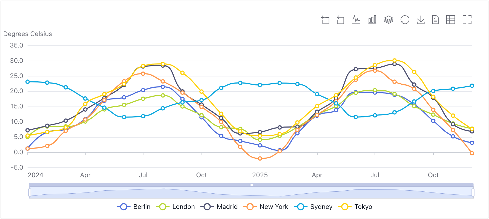
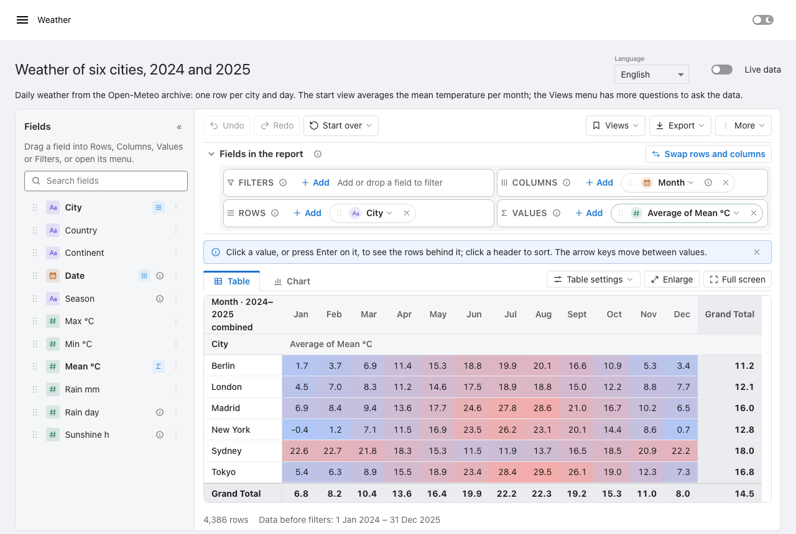
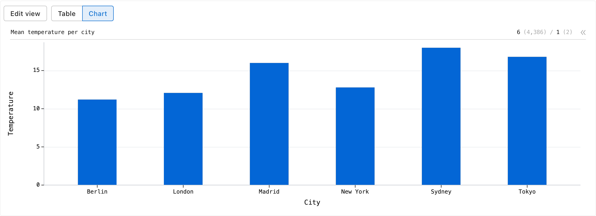
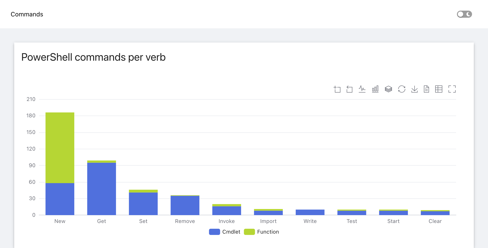

<p align="center">
  <picture>
    <source media="(prefers-color-scheme: dark)" srcset="assets/header-dark.svg">
    
  </picture>
</p>

<p align="center">
  Custom components for <a href="https://devolutions.net/powershell-universal/">PowerShell Universal</a> apps,
  each one a PowerShell module you install on its own: interactive <a href="https://echarts.apache.org/">Apache ECharts</a>
  charts, a <a href="https://perspective-dev.github.io/">Perspective</a> datagrid, pivot and chart, and a pivot report builder,
  fed straight from SQL, REST and PowerShell.
</p>

<p align="center">
  <a href="https://github.com/eizedev/powershell-universal-components/actions/workflows/ci.yml"></a>
  <a href="https://www.powershellgallery.com/profiles/Eizedev"></a>
  <a href="LICENSE"></a>
</p>

**[Documentation](https://powershell-universal-components.eize.dev/)** · [Getting started](https://powershell-universal-components.eize.dev/getting-started/) · [Requirements](https://powershell-universal-components.eize.dev/#requirements) · [Releases](https://github.com/eizedev/powershell-universal-components/releases)

> [!NOTE]
> The modules are 0.x. A minor release can break things, so read the module's `CHANGELOG.md` before
> you update.

## Modules

### ECharts

<picture><source media="(prefers-color-scheme: dark)" srcset="docs/assets/echarts-weather-dark.png"></picture>

`New-UDEChart` draws 29 [Apache ECharts](https://echarts.apache.org/) chart types, from bars and lines to gantt
charts, network graphs, and KPI matrices. Clicks filter other elements. Readers zoom, export, and go full screen.

- [Docs](https://powershell-universal-components.eize.dev/echarts/) · [PowerShell Gallery](https://www.powershellgallery.com/packages/PowerShellUniversal.Component.ECharts)
- Showcase app with 14 pages of examples: [Docs](https://powershell-universal-components.eize.dev/demo/) · [PowerShell Gallery](https://www.powershellgallery.com/packages/PowerShellUniversal.Component.ECharts.Demo)

### Pivot

<picture><source media="(prefers-color-scheme: dark)" srcset="docs/assets/pivot-showcase-weather-dark.png"></picture>

`New-UDPivotReport` is a pivot report builder on [pivotkit](https://pivotkit.eize.dev/) ([live demo](https://pivotkit.eize.dev/demo/)). Readers drag
fields into rows, columns, values and filters and get a table or a chart. They save views and export to Excel.

- [Docs](https://powershell-universal-components.eize.dev/pivot/) · [PowerShell Gallery](https://www.powershellgallery.com/packages/PowerShellUniversal.Component.Pivot)
- Showcase app with weather data, your own files and a ticket report: [Docs](https://powershell-universal-components.eize.dev/pivot/demo/) · [PowerShell Gallery](https://www.powershellgallery.com/packages/PowerShellUniversal.Component.Pivot.Demo)

### Perspective

<picture><source media="(prefers-color-scheme: dark)" srcset="docs/assets/perspective-weather-dark.png"></picture>

`New-UDPerspective` is the [Perspective](https://perspective-dev.github.io/) datagrid, pivot table, and WebGL
charts in one. Readers group, split, filter, and sort. A WebAssembly engine handles large row counts.

- [Docs](https://powershell-universal-components.eize.dev/perspective/) · [PowerShell Gallery](https://www.powershellgallery.com/packages/PowerShellUniversal.Component.Perspective)

## Quick start

```powershell
Install-PSResource -Name PowerShellUniversal.Component.ECharts
```

A first app that runs on any PSU server: the ten verbs with the most PowerShell commands.

```powershell
New-UDApp -Title 'Commands' -Content {
    $rows = Get-Command -CommandType Cmdlet, Function | Where-Object Verb |
        Group-Object Verb | Sort-Object Count -Descending |
        Select-Object -First 10 Name, Count
    New-UDEChart -Data $rows -Type bar -X Name -Y Count
}
```

With your own data it is the same call. From SQL Server, for example:

```powershell
$byTeam = Invoke-Sqlcmd -Query 'SELECT Team, Priority, COUNT(*) AS Tickets FROM Tickets GROUP BY Team, Priority'
New-UDEChart -Data $byTeam -Type bar -X Team -Y Tickets -GroupBy Priority -Stacked
```

[examples/quickstart.ps1](modules/PowerShellUniversal.Component.ECharts/examples/quickstart.ps1) splits the bars
into cmdlets and functions, and a click on a bar shows a toast:

<picture><source media="(prefers-color-scheme: dark)" srcset="assets/screenshot-quickstart-dark.png"></picture>

DataTables, `Invoke-RestMethod` results and PowerShell objects go in as they are. Column names match
without regard to case. A column name that matches no column shows the columns the data has.

Your own data from SQL, REST and PowerShell: [Getting started](https://powershell-universal-components.eize.dev/getting-started/).

## Questions and help

- Questions, ideas and what you built: [Discussions](https://github.com/eizedev/powershell-universal-components/discussions).
- Bugs and concrete feature requests: [issues](https://github.com/eizedev/powershell-universal-components/issues).
- Security problems: report them [privately](https://github.com/eizedev/powershell-universal-components/security/advisories/new), see [SECURITY.md](SECURITY.md).

## Development

Build, tests, docs site and releases: [Development](https://powershell-universal-components.eize.dev/development/).
Contributors and coding agents: [AGENTS.md](AGENTS.md), [CONTRIBUTING.md](CONTRIBUTING.md).

## License

[MIT](LICENSE). Bundled libraries keep their own licenses. The build writes their texts into each module's `THIRD-PARTY-NOTICES.txt`.
Icon, header and social preview in `assets/` are generated in [eizedev/brand](https://github.com/eizedev/brand)
and licensed [CC BY 4.0](https://creativecommons.org/licenses/by/4.0/). The weather in the screenshots: data by
[Open-Meteo.com](https://open-meteo.com/), [CC BY 4.0](https://creativecommons.org/licenses/by/4.0/), with modified Copernicus Climate Change Service information ([sources](docs/site/data/SOURCES.md)).
